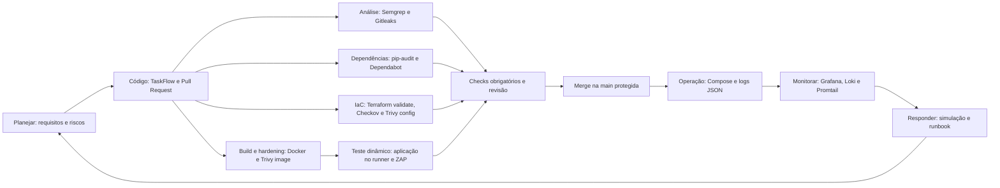
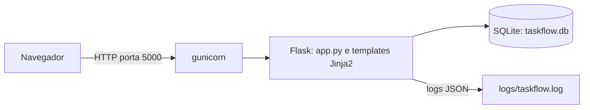
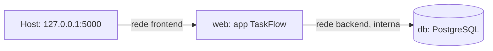
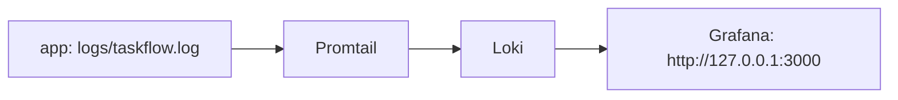
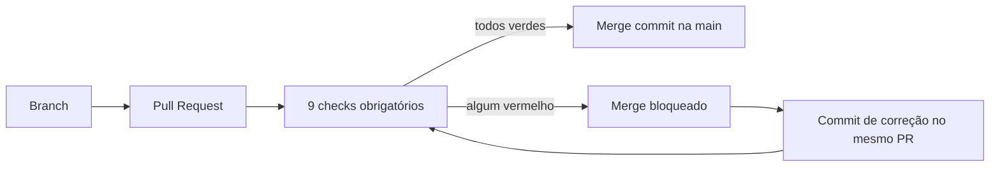

# TaskFlow DevSecOps

[](https://github.com/pauloed94/taskflow-fase-e/actions/workflows/ci.yml)
[](https://github.com/pauloed94/taskflow-fase-e/actions/workflows/sast.yml)
[](https://github.com/pauloed94/taskflow-fase-e/actions/workflows/sca.yml)
[](https://github.com/pauloed94/taskflow-fase-e/actions/workflows/dast.yml)
[](https://github.com/pauloed94/taskflow-fase-e/actions/workflows/iac-scan.yml)

Esteira segura de GitHub Actions para a aplicação **TaskFlow**, um app Flask que nasceu com vulnerabilidades de propósito. A esteira funciona como *quality gate*: nenhum código ou configuração entra na `main` sem passar pelo build e lint, pelo hardening da imagem (Trivy), pelo SAST (Semgrep), pelo secret scanning (Gitleaks), pelo SCA (pip-audit), pelo DAST (ZAP Baseline) e pelos scanners de IaC (Checkov e Trivy config). A observabilidade (logs JSON, Grafana, Loki e Promtail) e o runbook de resposta a incidente fazem parte do repositório, mas rodam **localmente**, fora do pipeline.

**Este repositório não tem nenhuma credencial**, nem na linha de base: a chave de sessão, as senhas de demonstração e a senha do Grafana vêm sempre de variáveis de ambiente (`.env` não versionado e `.env.example` só com nomes).

## Ciclo de desenvolvimento seguro (S-SDLC)



| Fase | Ferramenta | Check obrigatório | Workflow |
| --- | --- | --- | --- |
| Código | Ruff (lint) | `build-e-lint` | CI |
| Análise | Semgrep | `semgrep` | SAST |
| Análise | Gitleaks | `gitleaks` | SAST |
| Dependências | pip-audit e Dependabot | `pip-audit` | SCA |
| Build e hardening | Trivy na imagem | `imagem-trivy` | CI |
| Teste dinâmico | OWASP ZAP Baseline | `zap-baseline` | DAST |
| IaC | Terraform `fmt` e `validate` | `terraform` | IaC |
| IaC | Checkov | `checkov` | IaC |
| IaC | Trivy config | `trivy-config` | IaC |
| Operação e resposta | Compose, logs JSON, Grafana, Loki e runbook | (local, sem check) | — |

## Arquitetura

**A aplicação:** o gunicorn serve o Flask, que guarda os dados em um arquivo SQLite.



**O Compose seguro (`docker-compose.yml`):** dois serviços e duas redes. O banco PostgreSQL fica só na rede `backend`, que é interna, e não publica nenhuma porta no host.



O `web` participa das duas redes; o `db` só da `backend`. Um container que entre só na `frontend` não alcança o banco.

**A stack de observabilidade (`observability/`):** o Promtail lê o arquivo de log, o Loki o guarda, e o Grafana consulta.



**O caminho de uma alteração até a `main`:**



## Estrutura

```text
.
├── app/
│   ├── app.py                  # Aplicação Flask (com logging em JSON)
│   └── templates/              # Páginas Jinja2 (autoescape)
├── Dockerfile                  # Imagem endurecida (gunicorn, usuário sem privilégios)
├── .dockerignore
├── docker-compose.yml          # TaskFlow e banco, em modo seguro
├── .env.example                # Nomes das variáveis do Compose (o .env não é versionado)
├── requirements.txt            # Dependências sem CVEs conhecidas
├── infra/main.tf               # Terraform corrigido (nunca é aplicado, só escaneado)
├── .zap/rules.tsv              # Regras do ZAP, com justificativa por regra
├── observability/
│   ├── docker-compose.yml      # Loki, Promtail e Grafana
│   ├── promtail-config.yml
│   ├── grafana-provisioning/   # Loki como fonte de dados
│   ├── consultas-logql.md      # As consultas LogQL, com os resultados do ensaio
│   └── .env.example
├── docs/runbooks/forca-bruta.md  # Runbook de resposta a incidente
└── .github/
    ├── workflows/              # ci.yml, sast.yml, sca.yml, dast.yml e iac-scan.yml
    ├── CODEOWNERS
    └── dependabot.yml
```

## Execução local

A aplicação **exige** três variáveis de ambiente e se recusa a iniciar sem elas: `TASKFLOW_SECRET_KEY` (chave de sessão), `TASKFLOW_ADMIN_PASSWORD` e `TASKFLOW_USER_PASSWORD` (senhas dos usuários de demonstração `admin` e `aluno`, guardadas com hash no banco). Nenhuma é versionada.

```bash
python -m venv .venv
source .venv/bin/activate            # Windows (PowerShell): .venv\Scripts\Activate.ps1
pip install -r requirements.txt

export TASKFLOW_SECRET_KEY="$(python -c 'import secrets; print(secrets.token_hex(32))')"
export TASKFLOW_ADMIN_PASSWORD="uma-senha-sua"
export TASKFLOW_USER_PASSWORD="outra-senha-sua"
python app/app.py
```

No PowerShell, defina cada variável com `$env:NOME = "valor"`. O app abre em <http://127.0.0.1:5000>. O banco `taskflow.db` e a pasta `logs/` são criados no diretório de onde o comando roda (ambos ignorados pelo Git). O debug fica **desligado**; só liga com `TASKFLOW_DEBUG=1`.

**Com Docker:**

```bash
docker build -t taskflow .
docker run --rm -p 127.0.0.1:5000:5000 \
  -e TASKFLOW_SECRET_KEY="$(openssl rand -hex 32)" \
  -e TASKFLOW_ADMIN_PASSWORD="uma-senha-sua" \
  -e TASKFLOW_USER_PASSWORD="outra-senha-sua" taskflow
```

**Com o Compose seguro** (app e banco):

```bash
cp .env.example .env                 # preencha o .env com valores seus
docker compose up --build -d
docker compose ps                    # web e db devem ficar "healthy"
```

O Compose recusa subir se faltar qualquer variável. O `web` roda com o filesystem somente leitura (o banco e os logs vão para o `tmpfs`), sem capacidades extras e com limites de CPU e memória; o `db` não publica porta no host.

## Observabilidade e resposta a incidente (execução local)

Esta parte **não passa pelo pipeline**: demonstra-se rodando o repositório na própria máquina.

1. Crie a pasta de logs e suba a stack. A senha do Grafana vem do `.env` (não versionado):

   ```bash
   mkdir -p logs && chmod 777 logs
   cd observability
   cp .env.example .env              # preencha GRAFANA_ADMIN_PASSWORD
   docker compose up -d
   cd ..
   ```

2. Rode o app na raiz do repositório, como na seção anterior, com `python app/app.py`. Os logs saem em `logs/taskflow.log`. (Também dá para rodar o app em container com `-v "$PWD/logs":/app/logs`; a pasta precisa ser gravável pelo container.)
3. Abra <http://127.0.0.1:3000>, entre com `admin` e a senha do `.env`, vá em **Explore** com a fonte **Loki**.
4. Gere a simulação de força bruta:

   ```bash
   for i in $(seq 1 20); do
     curl -s -X POST http://127.0.0.1:5000/login -d "username=admin&password=tentativa$i" -o /dev/null
     sleep 0.2
   done
   ```

5. A query de detecção (a mesma do runbook) devolve o IP de origem com as falhas:

   ```logql
   sum by (ip) (count_over_time({job="taskflow"} | json | event="login_attempt" | result="failure" [5m])) >= 10
   ```

**Os logs:** uma linha JSON por evento (`login_attempt` com `result` de `success` ou `failure`, `logout`, `tasks_list_accessed`, `task_created` e `http_request`), cada uma com o `request_id` da requisição. **Senha, cookie, token e o texto das tarefas nunca vão para o log.** As seis consultas LogQL estão em [`observability/consultas-logql.md`](observability/consultas-logql.md), com os resultados de um ensaio; o runbook, com a condição de disparo, a query de detecção e as quatro fases do NIST SP 800-61, está em [`docs/runbooks/forca-bruta.md`](docs/runbooks/forca-bruta.md).

## Workflows e como disparar cada um

Todos têm os mesmos três gatilhos: `pull_request` (a cada commit de um PR), `push` na `main` (depois de cada merge) e `workflow_dispatch` (manual). Para disparar à mão, abra *Actions*, escolha o workflow e clique em **Run workflow**, ou use o GitHub CLI, por exemplo `gh workflow run ci.yml`.

| Workflow | Arquivo | Jobs (nome do check) | O que faz |
| --- | --- | --- | --- |
| CI | `ci.yml` | `build-e-lint` | instala as dependências e roda o Ruff em `app/` |
| | | `imagem-trivy` | builda a imagem e roda o Trivy como gate para HIGH e CRITICAL |
| SAST | `sast.yml` | `semgrep` | Semgrep com `p/python`, `p/flask` e `p/security-audit`, com `--error` |
| | | `gitleaks` | procura segredos em todo o histórico (`fetch-depth: 0`) |
| SCA | `sca.yml` | `pip-audit` | audita o `requirements.txt` contra a base de vulnerabilidades |
| DAST | `dast.yml` | `zap-baseline` | builda a imagem, sobe o app no runner (com chave e senhas geradas na hora), espera o `/login` responder e roda o ZAP Baseline; o relatório fica no artefato `zap_scan` |
| IaC | `iac-scan.yml` | `terraform` | `terraform fmt -check`, `init` e `validate` em `infra/` |
| | | `checkov` | Checkov (versão fixada) sobre o Terraform |
| | | `trivy-config` | Trivy config para HIGH e CRITICAL |

O **Dependabot** (`.github/dependabot.yml`) verifica uma vez por semana as bibliotecas Python e as actions, e abre PRs quando há versão nova. Os PRs dele passam pelos mesmos checks. O título de cada execução na aba Actions segue o padrão `NOME · PR aberto · branch` ou `NOME · commit novo no PR · branch` (chave `run-name`).

## Proteção da `main`

A `main` é protegida por um *ruleset* ativo, sem permissão de burlar: **PR obrigatório**, os **9 checks acima obrigatórios**, bloqueio de *force push* e de exclusão da branch. O `CODEOWNERS` define o dono de todo arquivo. Os PRs são mesclados com **merge commit** (nunca *squash*), para o histórico mostrar os commits de cada episódio.

Decisões de desenho dos workflows:

- **`permissions: contents: read`** em todos os workflows. Só o job do Gitleaks acrescenta `pull-requests: read`, que a action dele usa.
- **Actions de terceiros fixadas por SHA de commit**, com o número da versão em comentário; o Dependabot propõe as atualizações. As ferramentas instaladas por `pip` (Ruff, Semgrep, pip-audit) não têm versão fixada, exceto o Checkov.
- **Sem filtro `paths:` nos checks obrigatórios.** Um check obrigatório que só roda quando certos arquivos mudam deixaria PRs travados esperando um check que nunca dispara. Por isso o `iac-scan.yml` roda em todo PR, mesmo os que não tocam em `.tf`.
- **Nenhum gate é suprimido:** não há `continue-on-error`, `nosemgrep` nem `--exit-zero`. O ZAP roda com `fail_action: true`; sem isso, a action nunca reprovaria por alertas, e só três regras ficam em `IGNORE`, cada uma justificada no `.zap/rules.tsv`.
- **Sem segredos no código:** a chave do app, as senhas e a do Grafana vêm do ambiente, e o `dast.yml` gera valores aleatórios a cada execução.

## Resultados: antes × depois

| Ferramenta | Antes (linha de base) | Depois |
| --- | --- | --- |
| Semgrep | 9 achados | **0** |
| pip-audit | 51 vulnerabilidades em 5 pacotes | **0** |
| Trivy na imagem (HIGH e CRITICAL, com correção disponível) | 5 achados em 2026-11-07, todos em pacotes Python da base `python:latest` (o número varia de dia para dia, porque a base muda; chegou a 225 três dias antes) | **0** |
| ZAP Baseline | 5 `FAIL` e 2 `WARN`; o login dava erro 500 sob o gunicorn | **0** `FAIL`, **0** `WARN` (65 regras `PASS`) |
| Checkov (Terraform) | 9 aprovados e **16 falhas** | 38 aprovados, **0 falhas** e 7 skips justificados |
| Trivy config (Terraform) | **8** falhas (7 HIGH e 1 CRITICAL) | **0** |
| Gitleaks | sem achados: o repositório não tem credencial desde o primeiro commit | sem achados |

### Achados mapeados ao OWASP Top 10:2025

| Categoria | Achado | Quem achou | Correção |
| --- | --- | --- | --- |
| A01 Broken Access Control | Sem token CSRF nos formulários POST | ZAP (`10202`) | **risco aceito** (ver decisões); em produção, usar Flask-WTF |
| A02 Security Misconfiguration | `debug=True`, host `0.0.0.0` e `/debug/info` exposto | Semgrep e revisão | debug desligado por padrão e rota removida |
| | Cabeçalhos de segurança ausentes (CSP, anti-clickjacking, `nosniff`, Permissions-Policy, COOP, COEP e CORP) | ZAP (5 regras `FAIL`) | cabeçalhos HTTP no `app.py` |
| | Dockerfile com `python:latest`, root e servidor de desenvolvimento | revisão e Trivy | `python:3.12-slim`, usuário sem privilégios, gunicorn |
| | Banco não criado sob o gunicorn (login dava erro 500) | ZAP (alertas de erro) | `init_db()` ao carregar o módulo |
| | Terraform: SSH aberto para `0.0.0.0/0`, bucket sem bloqueio de acesso público, ACL `public-read` e saída irrestrita | Checkov e Trivy config | SSH por variável, bloqueio de acesso público, ACL privada, saída só em HTTPS |
| A03 Software Supply Chain Failures | Dependências antigas, 51 vulnerabilidades | pip-audit e Trivy | versões atualizadas em conjunto |
| A04 Cryptographic Failures | Senhas em texto puro no banco | revisão do código | hash com salt |
| | Terraform: bucket sem criptografia, sem versionamento e sem logging | Checkov e Trivy config | KMS próprio, versionamento e logging |
| A05 Injection | SQL Injection no login e na busca | Semgrep | consultas parametrizadas |
| | XSS armazenado, no parâmetro `q` e na mensagem de erro do login | Semgrep (o ZAP Baseline não detecta XSS armazenado) | templates Jinja2 com autoescape, sem `\|safe` |
| A09 Logging and Monitoring Failures | Sem logging estruturado nem detecção de ataque | — | logs JSON com `request_id`, stack Grafana e Loki, runbook |

## Decisões e riscos aceitos

- **`ignore-unfixed` no Trivy.** O gate só conta vulnerabilidades HIGH e CRITICAL que **já têm correção publicada**. As do sistema operacional sem correção não podem ser resolvidas por nós; a exceção fica à vista no workflow e deve ser reavaliada rodando o Trivy sem o filtro de tempos em tempos.
- **Gitleaks sem allowlist.** A linha de base foi limpa **antes do primeiro commit**, então não há segredo para liberar. Em testes, o Gitleaks acusa um token no formato de um serviço conhecido (como o do GitHub), mas não reconhece uma senha simples escrita como texto comum; por isso uma chave fixa no código seria pega pelo Semgrep, e não por ele. Se um dia acusar um segredo didático, a saída é uma allowlist específica por commit, justificada, e nunca desligar a regra nem o job.
- **CSRF aceito como risco.** O ZAP aponta a falta de token CSRF (`10202`), regra marcada `IGNORE` com justificativa em `.zap/rules.tsv`. Está fora do escopo do laboratório.
- **O ZAP Baseline não detecta XSS armazenado** (é passivo e não faz login). A proteção contra a volta do XSS e do debug é o Semgrep, que acusa os dois no código.
- **O banco do Compose é "de enfeite".** O serviço `db` (PostgreSQL) sobe e fica saudável para demonstrar as redes e as proteções, mas o app continua usando SQLite (em `/tmp`, efêmero). Os dados somem quando o container é recriado. Além disso, a senha do banco fica visível no `docker inspect` para quem tem acesso ao Docker; o passo seguinte seriam os Docker secrets, que não implementamos.
- **O Terraform nunca é aplicado.** Não há conta AWS: os scanners analisam o texto. Cada `#checkov:skip` tem a justificativa no próprio código, e as exceções do Trivy usam `trivy:ignore`.
- **O `/login` não limita tentativas.** É a causa raiz do incidente de força bruta, descrita no runbook, e a correção (limite por IP) **não está implementada**.
- **O limiar de detecção** (10 falhas em 5 minutos) é um ponto de partida e não foi calibrado com tráfego real. Não há alerta automático configurado, só a consulta.
- **Ordem dos episódios.** O SCA vem antes do container (o Trivy também reprova pelas bibliotecas antigas), e as correções de XSS e debug entram no PR do SAST (o Semgrep as acusa), para cada PR terminar verde com as suas próprias correções.

## Histórico em PRs

Cada PR conta um episódio: o gate entra e fica **vermelho**, o merge fica bloqueado, as correções entram como novos commits no **mesmo PR**, e só o verde é mesclado. A `main` nunca recebeu um commit vermelho.

| PR | Episódio | Vermelho | Verde |
| --- | --- | --- | --- |
| [#1](https://github.com/pauloed94/taskflow-fase-e/pull/1) | CI e CODEOWNERS | `import` sem uso (`F401`), merge bloqueado | import removido |
| [#2](https://github.com/pauloed94/taskflow-fase-e/pull/2) | SCA | `pip-audit`: 51 vulnerabilidades | dependências atualizadas, Dependabot |
| [#3](https://github.com/pauloed94/taskflow-fase-e/pull/3) | Container | Trivy na imagem original | Dockerfile corrigido |
| [#4](https://github.com/pauloed94/taskflow-fase-e/pull/4) | SAST e segredos | Semgrep: 9 achados | SQL Injection, hash, XSS e debug corrigidos |
| [#5](https://github.com/pauloed94/taskflow-fase-e/pull/5) | DAST | ZAP: 5 `FAIL` | banco no gunicorn e cabeçalhos de segurança |
| [#6](https://github.com/pauloed94/taskflow-fase-e/pull/6) | Compose seguro | (sem gate: o Compose não é lido pelos scanners) | provas locais do Compose |
| [#7](https://github.com/pauloed94/taskflow-fase-e/pull/7) | IaC | Checkov: 16 falhas; Trivy config: 8 | Terraform corrigido |
| [#8](https://github.com/pauloed94/taskflow-fase-e/pull/8) | Logging estruturado | (sem gate) | logs JSON com `request_id` |
| [#9](https://github.com/pauloed94/taskflow-fase-e/pull/9) | Stack e runbook | (sem gate) | consultas LogQL e runbook validados |

## Origem e linha de base

A aplicação vem do repositório do professor, <https://github.com/diegobuarquebr/taskflow>:

- `app/app.py` e `Dockerfile`: commit `063e1864ff202535fc3d09122fd0269a0ff49332` (2026-08-06), a versão original e vulnerável.
- `requirements.txt`: commit `da6fa1fc4411db9bca0a2bf65db3957e221eb619` (2026-08-28), com as versões antigas e vulneráveis, instalável hoje e com `gunicorn`.

O repositório de origem não declara licença; nenhuma foi presumida.

O primeiro commit deste repositório é a linha de base e recebe a tag `baseline`. Para reproduzir o "antes" das comparações: `git checkout baseline`.

A linha de base **não contém nenhuma credencial**. A aplicação original trazia uma chave de sessão e senhas de demonstração escritas no código e no `Dockerfile`; elas foram retiradas antes do primeiro commit, e a chave e as senhas passam a vir de variáveis de ambiente (`TASKFLOW_SECRET_KEY`, `TASKFLOW_ADMIN_PASSWORD` e `TASKFLOW_USER_PASSWORD`). As demais vulnerabilidades continuam de propósito.
